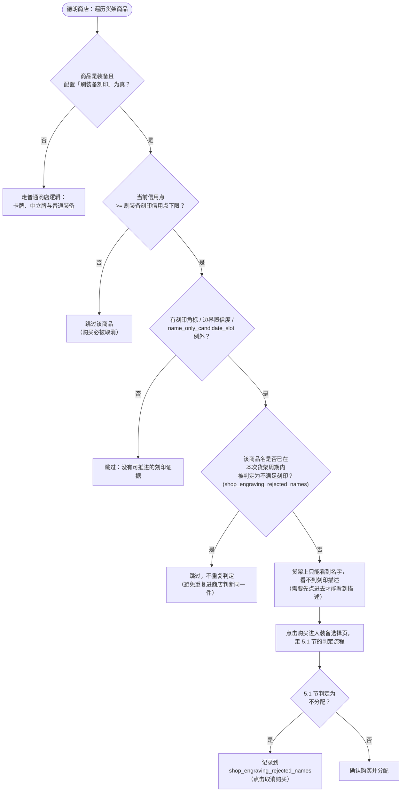
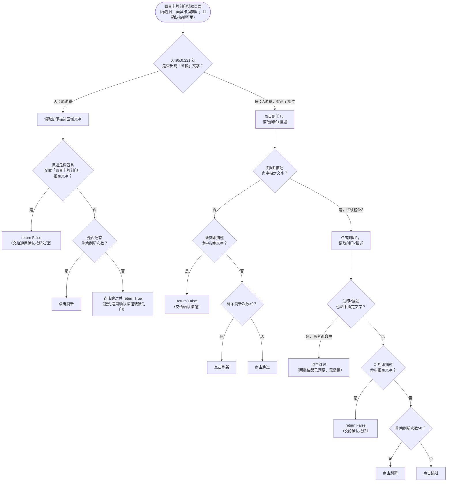
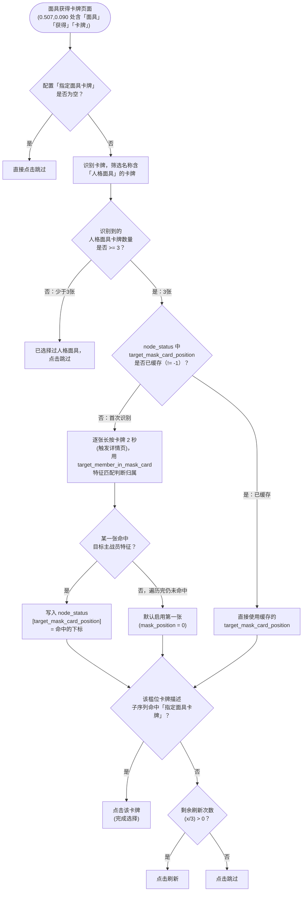

# 15. Python ChaosMode 流程基线图（2026-10-14）

> 本文档只做梳理和可视化，不包含任何代码修改。Python 源码已冻结不再变动，因此本文档可作为长期有效的迁移对照基线，供人工核对，也供 AI 读取代码时建立全局上下文（避免逐函数阅读时丢失跨函数的状态耦合关系）。
>
> 数据来源：
> - `PAGE_HANDLERS` 顺序：直接读取 `D:\work\ok\ok-kes\ok_tasks\utils_chaos.py:1036-1114`。
> - 72 个处理器的命中条件、状态读写细节：已于 2026-10-14 按当前 `D:\work\ok\ok-kes` 源码重新核对；字段数量和业务分支以当前 Python 实现为准。
> - `node_status`/`member_status` 初始化：`ChaosMode.py:96-103`。

## 1. 两张图分别解决什么问题

- **图一（调度顺序图）**：回答"任意一帧，72 个处理器按什么固定顺序被尝试，谁的优先级高于谁"。对照 C# `FrameRouter` 路由表时，用它核对顺序是否一致、有没有遗漏。
- **图二（状态耦合图）**：回答"`node_status`/`member_status` 里的每个字段，被哪些处理器读、被哪些处理器写"。这是 ERR-001/ERR-003 等历史问题的根因可视化——状态字段被多个处理器交叉读写、没有单一拥有者，正是旧架构反复出 bug 的原因。对照 C# `ChaosRunState`/`ActionArbiter` 时，用它验证新架构是否真的消灭了这种耦合。

## 2. 图一：处理器调度顺序图（72 项全量，严格按 PAGE_HANDLERS 顺序）

逐帧执行逻辑：`for handle_page in PAGE_HANDLERS: if handle_page(self): return`。即从第 1 项开始依次尝试，第一个返回 `True` 的处理器"认领"本帧，之后的处理器本帧不会被调用；如果全部返回 `False`，本帧无人处理。

```mermaid
flowchart TD
    START(["新一帧 OCR 完成\nall_texts 已更新"]) --> h1

    subgraph G1["生命周期与日志（无视觉拦截/弱拦截）"]
        h1["1 handle_auto_stop\n达到停止轮数则禁用任务"]
        h2["2 handle_save_target_member\n主界面且配置了刷存档主战员"]
        h3["3 handle_route_selection\n路线选择页：规划下一节点"]
        h4["4 log_credit\n仅记录信用点，不拦截"]
        h5["5 log_node_status\n仅记录全部状态，不拦截"]
        h6["6 handle_stuck_log\n画面卡住兜底"]
        h1 -->|未命中| h2 -->|未命中| h3 -->|未命中| h4 -->|未命中| h5 -->|未命中| h6
    end

    subgraph G2["通用弹窗与确认（高优先级，可能遮住其他页面）"]
        h7["7 handle_close_page\n点击屏幕关闭页面"]
        h8["8 handle_refine_equipment_credit\n以信用点接收提炼"]
        h9["9 handle_center_confirm\n页面中央确认按钮"]
        h6 -->|未命中| h7 -->|未命中| h8 -->|未命中| h9
    end

    subgraph G3["卡厄思专属：主战员存档与面具"]
        h10["10 handle_archive_target_member\n信息统计页记录目标主战员"]
        h11["11 handle_chaos_mask_engraving\n面具卡牌刻印获取"]
        h9 -->|未命中| h10 -->|未命中| h11
    end

    subgraph G4["装备、卡牌分配、通用按钮"]
        h12["12 handle_equipment\n装备选择"]
        h13["13 handle_card_assign\n卡牌奖励分配给主战员"]
        h14["14 handle_confirm\n底部确认按钮"]
        h15["15 handle_mask_card\n面具获得卡牌页面"]
        h16["16 handle_convert\n转换按钮"]
        h11 -->|未命中| h12 -->|未命中| h13 -->|未命中| h14 -->|未命中| h15 -->|未命中| h16
    end

    subgraph G5["商店/休息与常见操作按钮"]
        h17["17 handle_shop\n德朗商店"]
        h18["18 handle_rest\n休息/冥想/商店入口"]
        h19["19 handle_close_button\n关闭按钮"]
        h20["20 handle_remove\n移除按钮"]
        h21["21 handle_three_choice_card_remove\n三选一移除（低优先级兜底）"]
        h22["22 handle_flash\n闪光按钮"]
        h23["23 handle_reflash\n重新闪光按钮"]
        h24["24 handle_grant_flash\n赋予闪光按钮"]
        h25["25 handle_copy\n复制按钮"]
        h26["26 handle_leave\n离开按钮"]
        h16 -->|未命中| h17 -->|未命中| h18 -->|未命中| h19 -->|未命中| h20 -->|未命中| h21 -->|未命中| h22 -->|未命中| h23 -->|未命中| h24 -->|未命中| h25 -->|未命中| h26
    end

    subgraph G6["高优先级结算/异常（优先于下一步按钮）"]
        h27["27 handle_mental_breakdown\n精神崩溃"]
        h28["28 handle_data_collected\n存储数据收集完成"]
        h29["29 handle_expedition_result\n探险结果（重置单局状态）"]
        h26 -->|未命中| h27 -->|未命中| h28 -->|未命中| h29
    end

    subgraph G7["常见确认类按钮"]
        h30["30 handle_next_step\n下一步按钮"]
        h31["31 handle_craft\n合成按钮"]
        h32["32 handle_select\n选择按钮"]
        h33["33 handle_go_to_chaos_core\n前往卡厄思核心"]
        h34["34 handle_equipment_recast\n装备重铸"]
        h29 -->|未命中| h30 -->|未命中| h31 -->|未命中| h32 -->|未命中| h33 -->|未命中| h34
    end

    subgraph G8["战斗相关"]
        h35["35 handle_minimizemap\n小地图"]
        h36["36 handle_weakness_info\n弱点信息"]
        h37["37 handle_non_battle_page\n故事/营救/方舟城市（禁用任务）"]
        h38["38 handle_battle_crash\n画面错乱重试"]
        h39["39 handle_battle_auto_check\n手牌检测+自动战斗开关"]
        h34 -->|未命中| h35 -->|未命中| h36 -->|未命中| h37 -->|未命中| h38 -->|未命中| h39
    end

    subgraph G9["结算、命运、卡牌奖励"]
        h40["40 handle_settlement\n结算（重置层状态）"]
        h41["41 handle_destiny_choice\n命运选择（随机）"]
        h42["42 handle_main_member_flash\n主战员闪光获得"]
        h43["43 handle_card_reward\n卡牌奖励"]
        h44["44 handle_select_card\n选择N张卡牌"]
        h45["45 handle_copy_member\n选择复制卡牌的主战员"]
        h46["46 handle_convert_card\n转换的卡牌"]
        h47["47 handle_discovery_select\n发现选择（存储数据层级）"]
        h48["48 handle_negotiation\n谈判/掷骰子失败"]
        h39 -->|未命中| h40 -->|未命中| h41 -->|未命中| h42 -->|未命中| h43 -->|未命中| h44 -->|未命中| h45 -->|未命中| h46 -->|未命中| h47 -->|未命中| h48
    end

    subgraph G10["卡厄思奖励结算与通用继续"]
        h49["49 handle_chaos_reward_settlement\n卡厄思奖励结算（高优先级）"]
        h50["50 handle_chaos_reward_claim\n奖励领取（验证卡判断）"]
        h51["51 handle_continue\n继续按钮"]
        h48 -->|未命中| h49 -->|未命中| h50 -->|未命中| h51
    end

    subgraph G11["初始页面与进入（优先于进入按钮）"]
        h52["52 handle_season_chaos_initial_page\n赛季卡厄思初始页"]
        h53["53 handle_zero_system_initial_page\n零式系统初始页"]
        h54["54 handle_disable_adaptation_distortion\n刷空档关闭适应畸变（return False但有点击）"]
        h55["55 handle_enter\n进入按钮（重置单局状态）"]
        h56["56 handle_obtain_reward\n获得"]
        h51 -->|未命中| h52 -->|未命中| h53 -->|未命中| h54 -->|未命中| h55 -->|未命中| h56
    end

    subgraph G12["闪光卡牌与治疗"]
        h57["57 handle_view_original\n卡牌闪光决定页"]
        h58["58 handle_trauma_center\n创伤中心"]
        h59["59 handle_treating\n治疗方法选择"]
        h60["60 handle_treat_approve\n点击批准"]
        h56 -->|未命中| h57 -->|未命中| h58 -->|未命中| h59 -->|未命中| h60
    end

    subgraph G13["零式系统/法典/合成杂项"]
        h61["61 handle_zero_system_home\n零式系统首页"]
        h62["62 handle_codex_search\n法典搜索"]
        h63["63 handle_expedition_unlock\n解锁探险记录"]
        h64["64 handle_memory_elimination\n记忆消除"]
        h65["65 handle_chaos_craft\n卡厄思合成"]
        h66["66 handle_conquer_difficulty\n征服新难度"]
        h60 -->|未命中| h61 -->|未命中| h62 -->|未命中| h63 -->|未命中| h64 -->|未命中| h65 -->|未命中| h66
    end

    subgraph G14["低优先级兜底：复制、跳过、事件、收尾"]
        h67["67 handle_copy_card_choice\n选择要复制的卡牌"]
        h68["68 handle_skip\n跳过按钮"]
        h69["69 handle_event_task\n事件任务选项"]
        h70["70 handle_held_cards_page\n持有卡牌页"]
        h71["71 handle_escape\n逃脱"]
        h72["72 handle_stage_end_data_details\n关卡结束数据详情（最低优先级）"]
        h66 -->|未命中| h67 -->|未命中| h68 -->|未命中| h69 -->|未命中| h70 -->|未命中| h71 -->|未命中| h72
    end

    h72 -->|未命中| NONE(["本帧无处理器命中\n（仅调用 check_upload_if_needed）"])
```



### 关键顺序观察点（供对照 C# 迁移时重点核查）

- `handle_route_selection`（#3）排在极前面，几乎所有其他页面判断都在它之后，意味着一旦被误判为路线选择页，会抢占本应属于其他页面的处理机会。
- `handle_center_confirm`（#9）、`handle_confirm`（#14）两个通用确认按钮分别出现在流程早期和中期，中间插入了 `handle_archive_target_member`/`handle_chaos_mask_engraving`/`handle_equipment`/`handle_card_assign`/`handle_mask_card` 五个业务页面，说明 Python 版本本身也不是"一个确认协议服务所有页面"，这与 C# 侧 `11-region-slices-and-event-bus.md` 里提到的重构目标形成对照。
- `handle_three_choice_card_remove`（#21）明确标注"低优先级兜底"，排在 `handle_remove`（#20）之后。
- `handle_mental_breakdown`/`handle_data_collected`/`handle_expedition_result`（#27-29）明确标注"优先于下一步按钮"，插在 `handle_leave`（#26）和 `handle_next_step`（#30）之间。
- `handle_settlement`（#40）和 `handle_enter`（#55）是两个状态重置枢纽（分别调用 `reset_layer_status`/`reset_mission_status`），但两者在顺序上相距 15 个处理器，中间夹着命运选择、卡牌奖励、谈判等大量业务页面。
- `handle_chaos_reward_settlement`（#49）明确标注"优先级高于继续按钮"，但 `handle_continue`（#51）本身也排在比较靠后的位置，中间只隔了 `handle_chaos_reward_claim`（#50）。
- `handle_season_chaos_initial_page`/`handle_zero_system_initial_page`/`handle_disable_adaptation_distortion`（#52-54）三者都明确标注"优先于进入按钮"，紧贴在 `handle_enter`（#55）之前。
- `handle_disable_adaptation_distortion`（#54）是一个容易被误读的例外：它内部确实执行了点击（关闭适应畸变开关），但函数返回 `False`，所以不会阻止后续处理器在同一帧继续被尝试——这是 Python 里"命中但不独占本帧"的少数特例，迁移时如果简单理解为"返回 False 就等于没做任何事"会漏掉这个点击动作。
- `handle_copy_card_choice`/`handle_skip`/`handle_event_task`/`handle_held_cards_page`/`handle_escape`/`handle_stage_end_data_details`（#67-72）全部集中在队列最末端，是整条链路里优先级最低的一组。

## 3. 图二：状态字段 ↔ 处理器读写关系图

72 个处理器中，约三分之二是"纯 UI 点击型"（命中固定文案/坐标即点击，不读写 `node_status`/`member_status`），这部分不逐一连线，只在图末尾汇总列出，避免图过度膨胀。下图只展开**真正参与状态读写**的处理器和两个关键的"状态重置枢纽"辅助函数（`reset_layer_status`、`reset_mission_status`，它们不是 `PAGE_HANDLERS` 里的页面处理器，而是被多个处理器调用的共享函数，但对状态字段的影响面最大，是图里连线最密集的节点）。

```mermaid
graph LR
    subgraph NS["node_status 字段（共18个，17个初始化+1个运行时动态）"]
        f_shop["shop"]
        f_flash_or_rest["flash_or_rest"]
        f_reach_final_boss["reach_final_boss"]
        f_final_boss_battle["final_boss_battle"]
        f_pass_final_boss_count["pass_final_boss_count"]
        f_total_rounds["total_rounds"]
        f_success_rounds["success_rounds"]
        f_node_count["node_count"]
        f_enter_new_node["enter_new_node"]
        f_node_type["node_type"]
        f_is_escaped["is_escaped"]
        f_save_target_member["save_target_member"]
        f_target_mask_card_position["target_mask_card_position"]
        f_get_specific_flash["get_specific_flash"]
        f_removed_card_count["removed_card_count"]
        f_shop_removed_card_count["shop_removed_card_count"]
        f_neutral_card_count["neutral_card_count"]
        f_shop_engraving_rejected["shop_engraving_rejected_names\n（运行时动态key，reset时清除）"]
    end

    subgraph MS["member_status 字段"]
        m_equipment["equipment.names/descriptions/qualities"]
        m_deck["deck（卡牌名->描述）"]
        m_deck_meditation["deck.冥想（卡牌名->bool，配置驱动，重置任务时重建）"]
    end

    subgraph HUB["状态重置枢纽（非页面处理器，被多个handler调用）"]
        reset_layer["reset_layer_status\n(由 handle_settlement 调用)\n保留9个字段，其余重置为初始值"]
        reset_mission["reset_mission_status\n(由 handle_expedition_result /\nhandle_enter 调用)\n保留3个字段，其余重置为初始值"]
    end

    subgraph HANDLERS["涉及状态读写的处理器"]
        h1["1 handle_auto_stop"]
        h2["2 handle_save_target_member"]
        h3["3 handle_route_selection"]
        h5["5 log_node_status（只读，打印全部字段）"]
        h10["10 handle_archive_target_member"]
        h12["12 handle_equipment"]
        h13["13 handle_card_assign"]
        h15["15 handle_mask_card"]
        h17["17 handle_shop"]
        h18["18 handle_rest"]
        h20["20 handle_remove"]
        h21["21 handle_three_choice_card_remove"]
        h29["29 handle_expedition_result"]
        h39["39 handle_battle_auto_check"]
        h40["40 handle_settlement"]
        h43["43 handle_card_reward"]
        h49["49 handle_chaos_reward_settlement"]
        h55["55 handle_enter"]
        h57["57 handle_view_original"]
        h69["69 handle_event_task"]
        h71["71 handle_escape"]
    end

    h1 -->|读| f_total_rounds

    h2 -->|写| f_save_target_member

    h3 -->|读| f_enter_new_node
    h3 -->|读| f_flash_or_rest
    h3 -->|读| f_pass_final_boss_count
    h3 -->|写| f_enter_new_node
    h3 -->|写| f_node_count
    h3 -->|写| f_flash_or_rest
    h3 -->|写| f_shop
    h3 -->|写| f_reach_final_boss
    h3 -->|写| f_node_type

    h5 -.读全部字段.-> f_shop
    h5 -.读.-> m_equipment
    h5 -.读.-> m_deck_meditation

    h10 -->|写| f_save_target_member

    h12 -->|读写| m_equipment

    h13 -->|读| f_neutral_card_count
    h13 -->|读写| m_deck

    h15 -->|读写| f_target_mask_card_position

    h17 -->|读| f_shop
    h17 -->|读| f_shop_removed_card_count
    h17 -->|读| f_shop_engraving_rejected
    h17 -->|读| f_neutral_card_count
    h17 -->|写| f_shop
    h17 -->|写| f_shop_engraving_rejected

    h18 -->|读| f_flash_or_rest
    h18 -->|读| f_shop
    h18 -->|写| f_flash_or_rest
    h18 -->|读写| m_deck_meditation

    h20 -->|写经由_record_removed_cards| f_removed_card_count
    h20 -->|条件写（商店来源）| f_shop_removed_card_count
    h21 -->|写经由_record_removed_cards| f_removed_card_count
    h21 -->|条件写（商店来源）| f_shop_removed_card_count

    h29 -->|读| f_total_rounds
    h29 -->|读| f_pass_final_boss_count
    h29 -->|读| f_is_escaped
    h29 -->|读| f_success_rounds
    h29 -->|写| f_total_rounds
    h29 -->|写| f_success_rounds
    h29 -.调用.-> reset_mission

    h39 -->|读| f_reach_final_boss
    h39 -->|写| f_final_boss_battle

    h40 -->|读| f_reach_final_boss
    h40 -->|写| f_pass_final_boss_count
    h40 -.调用.-> reset_layer

    h43 -->|读| f_pass_final_boss_count
    h43 -->|读| f_node_count

    h49 -->|读| f_is_escaped
    h49 -->|读| f_pass_final_boss_count
    h49 -->|读| f_get_specific_flash
    h49 -->|写| f_success_rounds

    h55 -.调用.-> reset_mission

    h57 -->|写| f_get_specific_flash
    h57 -->|读写| m_deck_meditation

    h69 -->|读| f_pass_final_boss_count
    h69 -->|读| f_node_count

    h71 -->|写| f_is_escaped

    reset_layer -.重置（清空）.-> f_shop
    reset_layer -.重置（清空）.-> f_flash_or_rest
    reset_layer -.重置（清空）.-> f_reach_final_boss
    reset_layer -.重置（清空）.-> f_final_boss_battle
    reset_layer -.重置（清空）.-> f_node_count
    reset_layer -.重置（清空）.-> f_enter_new_node
    reset_layer -.重置（清空）.-> f_node_type
    reset_layer -.重置（清空）.-> f_is_escaped
    reset_layer -.重置（清空）.-> f_shop_engraving_rejected
    reset_layer -.保留.-> f_pass_final_boss_count
    reset_layer -.保留.-> f_total_rounds
    reset_layer -.保留.-> f_success_rounds
    reset_layer -.保留.-> f_save_target_member
    reset_layer -.保留.-> f_target_mask_card_position
    reset_layer -.保留.-> f_get_specific_flash
    reset_layer -.保留.-> f_removed_card_count
    reset_layer -.保留.-> f_shop_removed_card_count
    reset_layer -.保留.-> f_neutral_card_count

    reset_mission -.保留.-> f_total_rounds
    reset_mission -.保留.-> f_success_rounds
    reset_mission -.保留.-> f_save_target_member
    reset_mission -.重置（清空）.-> f_shop
    reset_mission -.重置（清空）.-> f_flash_or_rest
    reset_mission -.重置（清空）.-> f_pass_final_boss_count
    reset_mission -.重置（清空）.-> f_node_count
    reset_mission -.重置（清空）.-> f_removed_card_count
    reset_mission -.重置（清空）.-> f_shop_removed_card_count
    reset_mission -.重置（清空）.-> m_equipment
    reset_mission -.重置（清空）.-> m_deck
```



### 关键耦合观察点（供对照 C# `ChaosRunState`/`ActionArbiter` 时重点核查）

1. **`pass_final_boss_count` 是全图连接度最高的字段之一**：被 `handle_route_selection`（读）、`handle_expedition_result`（读）、`handle_settlement`（写）、`handle_card_reward`（读）、`handle_chaos_reward_settlement`（读）、`handle_event_task`（读）五个处理器直接读写，还通过 `reset_layer_status` 被保留、通过 `reset_mission_status` 被清空。任何修改这个字段语义的改动，影响面覆盖了结算、路线规划、卡牌奖励、事件三大核心流程。
2. **`shop` 字段同时被三个不同语义的处理器写入/读取**：`handle_route_selection`（进入新节点时按配置写入）、`handle_shop`（商店页面内读写）、`handle_rest`（读取判断是否要进商店），三者没有一个统一的"商店状态拥有者"，这正是 `12-design-errors-and-guardrails.md` 里 ERR-001 描述的"通用行为页面化"同类模式，只是这次是数据状态而不是动作状态。
3. **`reset_layer_status` 和 `reset_mission_status` 保留/清空的字段集合不同且有重叠**：两者都保留 `save_target_member`，但 `reset_layer_status` 额外保留 `pass_final_boss_count`/`total_rounds`/`success_rounds`/`target_mask_card_position`/`get_specific_flash`/`removed_card_count`/`shop_removed_card_count`/`neutral_card_count`，而 `reset_mission_status` 只保留 `total_rounds`/`success_rounds`/`save_target_member`，其余全部清空（包括 `reset_layer_status` 会保留的字段）。换句话说，同一个字段在"过关底 BOSS"和"重新进入副本"两种重置时机下，生命周期策略完全不同。迁移到 C# 时，`ChaosRunState.ResetLayer()`/`ResetMission()` 必须严格对应这两套不同的保留清单，任何一个字段放错了保留/清空分组，都会在特定重置路径下产生状态泄漏或意外清零。
4. **`deck.冥想` 和 `shop_engraving_rejected_names` 的生命周期并不相同。** `deck.冥想` 挂在 `member_status.deck` 下，由 `_reset_meditation_state` 在 `reset_mission_status`/`reset_all_status` 时按配置重建；`reset_layer_status` 完全不触碰它。`shop_engraving_rejected_names` 才是 `node_status` 里惰性创建的运行时动态 key，只要 `node_status` 被整体重建就会消失。迁移到强类型 C# 状态时必须分别处理，不能合并成同一种生命周期。

5. **`reset_layer_status` 刻意不触碰冥想状态和待处理移除计数，但 C# 的 `ResetLayer()` 把这两项清空了（已核实为真实差异，不是设计意图）。** Python 的 `reset_layer_status`（`utils.py:5464-5486`）只重建并部分恢复 `node_status` 字典的 9 个字段，**完全没有调用** `_reset_meditation_state(task)`，**也完全没有触碰** `task._pending_removed_card_count`——这是和 `reset_mission_status`/`reset_all_status`（两者都会做这两件事）刻意区分开的设计："过关进入下一层"场景下，冥想追踪状态和待处理的移除卡牌计数要原样延续到下一层，不能清空。C# 的 `ChaosRunState.ResetLayer()` 内部调用了 `ResetAll()`，而 `ResetAll()` 会无条件执行 `MeditationCards.Clear()` 和 `PendingRemovedCardCount = 0`，`ResetLayer()` 的保留清单里没有把这两项加回去，导致执行完之后这两个状态被意外清空。详细记录和建议见 `13-migration-review-findings.md` 第 1.2 节。

### 未展开的纯 UI 点击型处理器（共约 51 个，不读写 node_status/member_status）

以下处理器只读取画面文字/坐标并直接点击或触发 `task.disable()`，不涉及本图的状态字段，因此未在图二中逐一连线（完整的命中条件和定义位置见本次子代理分析原文，已整理进本仓库会话记录，如需要可以单独整理为附表）：

```text
handle_stuck_log, handle_close_page, handle_refine_equipment_credit, handle_center_confirm,
handle_chaos_mask_engraving, handle_confirm, handle_convert, handle_close_button,
handle_flash, handle_reflash, handle_grant_flash, handle_copy, handle_leave,
handle_mental_breakdown, handle_data_collected, handle_next_step, handle_craft,
handle_select, handle_go_to_chaos_core, handle_equipment_recast, handle_minimizemap,
handle_weakness_info, handle_non_battle_page, handle_battle_crash, handle_destiny_choice,
handle_main_member_flash, handle_select_card, handle_copy_member, handle_convert_card,
handle_discovery_select, handle_negotiation, handle_chaos_reward_claim, handle_continue,
handle_season_chaos_initial_page, handle_zero_system_initial_page,
handle_disable_adaptation_distortion, handle_obtain_reward, handle_trauma_center,
handle_treating, handle_treat_approve, handle_zero_system_home, handle_codex_search,
handle_expedition_unlock, handle_memory_elimination, handle_chaos_craft,
handle_conquer_difficulty, handle_copy_card_choice, handle_skip, handle_held_cards_page,
handle_stage_end_data_details, log_credit
```

## 4. 使用建议

- 这两张图建议作为 Chaos 模式迁移审查的常驻参照物，和 `10-chaos-mode-migration-ledger.md`（迁移台账）、`12-design-errors-and-guardrails.md`（设计错误记录）、`13-migration-review-findings.md`（本次迁移差异审查）配合使用。
- 后续如果要对某个具体处理器做"Python vs C#"行为对比，可以先在图一里定位它在原始优先级链条中的位置，再在图二里查它涉及哪些状态字段，比直接去源码里搜索更快建立上下文。
- 如果后续要新增 C# 侧的对照图（例如 `FrameRouter` 路由优先级图），建议单独成文，不要并入本文档——本文档的前提是"Python 源码已冻结"，C# 侧仍在变动，混在一起会导致本文档也需要持续维护，违背最初建立基线文档的目的。

## 5. 补充：刻印与面具卡牌业务流程图（2026-10-14，为未来迁移准备）

> 这两块功能在 Python 里完整存在。C# 的 `ChaosModeConfigSchema.cs` 已经定义"指定面具卡牌""面具卡牌刻印""装备刻印优先级""刷装备刻印信用点下限""刻印专业模式""商店删卡信用点下限""商店删卡次数上限"七个配置项，但这些配置对应的页面处理器和运行逻辑仍按迁移台账标注为"待迁移"或"暂缓"；当前 C# 商店与装备处理器只覆盖普通流程。
>
> 本节补上这两块的决策流程图，供未来真正实现时参照，并在第 6 节评估现有架构是否兼容这类需求。

### 5.1 装备刻印模式（`刷装备刻印`）决策流程

Python 核心判定逻辑独立成一个纯函数模块 `utils_equipment_engraving.py`（`should_assign_to_target_member`），不依赖 `TriggerTask`、不做任何截图/OCR/点击，可以脱离游戏环境单独测试——这个设计本身值得 C# 迁移时参照（见第 6 节）。

```mermaid
flowchart TD
    START(["装备选择页面：候选装备 vs 槛位当前装备"]) --> CHECK_MODE{"配置「刷装备刻印」\n是否为真？"}
    CHECK_MODE -->|否| OLD_LOGIC["沿用原有逻辑：\n_should_install_equipment\n（优先级+品质比较，\n已在 C# ChaosEquipmentLogic 中实现，\n但缺传说装备互斥判断，见13号文档1.3节）"]
    CHECK_MODE -->|是| SLOT_DONE{"槛位已完成？\n(当前装备命中目标名\nAND 当前描述命中\n任意一项目标刻印)"}

    SLOT_DONE -->|是| REJECT_DONE["不分配，继续检查下一个候选\n（已完成的槛位不再替换）"]

    SLOT_DONE -->|否| CMP_RANK{"候选命中的刻印排名\nvs 槛位当前刻印排名\n（排名=装备刻印优先级列表下标，\n越小越优；None=无目标刻印）"}

    CMP_RANK -->|候选更优\n(candidate_rank < slot_rank\n或 slot_rank 为空)| ASSIGN_BETTER["分配给目标主战员\n（优先占住更优刻印，\n不论候选名字是否命中）"]

    CMP_RANK -->|候选无目标刻印\ncandidate_rank 为空| CHECK_NON_TARGET_ENGRAVING{"候选是否自带非目标刻印？\n(candidate_has_engraving == True)"}
    CHECK_NON_TARGET_ENGRAVING -->|是| REJECT_NON_TARGET["不分配：候选自带非目标刻印\n覆盖会导致刻印降级"]
    CHECK_NON_TARGET_ENGRAVING -->|否| CHECK_NAME_ONLY{"候选命中目标名列表？"}
    CHECK_NAME_ONLY -->|是| ASSIGN_INHERIT["分配给目标主战员\n（继承机制：真正不带刻印的装备\n会继承槛位原有刻印，不降级）"]
    CHECK_NAME_ONLY -->|否| REJECT_NO_PROGRESS["不分配：\n既未命中目标名，\n也不带任何目标刻印，无进展"]

    CMP_RANK -->|候选同等优先级\ncandidate_rank == slot_rank| CHECK_NAME_SAME{"候选命中目标名列表？"}
    CHECK_NAME_SAME -->|是| ASSIGN_SAFE_RENAME["分配给目标主战员\n（刻印等级不变，\n换名是安全进展）"]
    CHECK_NAME_SAME -->|否| REJECT_NO_NAME_PROGRESS["不分配：\n刻印等级不变，\n名字也没有进展"]

    CMP_RANK -->|候选更差\ncandidate_rank > slot_rank| REJECT_DOWNGRADE["绝不分配：\n候选自带较差刻印会覆盖槛位，\n造成刻印降级（与继承机制\n完全不同，必须严格区分）"]
```

**配套的商店购买侧逻辑**（`handle_shop` 内，`utils.py:4853-5229`，刻印预筛选见 `utils.py:4937-5059`）：



### 5.2 面具卡牌刻印获取页面（`handle_chaos_mask_engraving`）决策流程



### 5.3 面具获得卡牌页面（`handle_mask_card`）决策流程



**关键点**：`target_mask_card_position` 是跨帧持久化状态（`node_status` 的 16 个初始字段之一，已经在图二里出现过），一旦识别出目标主战员所在的卡牌位置就会缓存，避免每次都重新用长按+特征匹配的方式检测归属（这个检测本身是破坏性操作：长按会打开详情页，需要再点关闭）。

## 6. 架构兼容性评估：现有 C# 设计能否承载刻印与面具功能

### 6.1 结论先行

**现有架构在"状态模型"和"业务决策/视觉识别/输入分离"这两个核心设计原则上，可以兼容这两块功能，不需要推翻重做。** 但有三个具体缺口需要在实现前补上，否则会重新引入旧架构的耦合问题（即 `12-design-errors-and-guardrails.md` 记录的那类错误）。

### 6.2 兼容的部分

1. **`should_assign_to_target_member` 这类纯判定函数天然适配 C# 的分层设计。** Python 原作者已经把刻印判定逻辑写成了不依赖游戏环境的纯函数（`utils_equipment_engraving.py`），这正好对应 C# 现有的 `ChaosEquipmentLogic`（纯逻辑类，`DecideInstall` 方法）的设计模式——两边的架构哲学是一致的。迁移时可以直接在 `ChaosEquipmentLogic` 里新增一个 `DecideEngravingAssignment` 方法，复刻 `should_assign_to_target_member` 的 8 种情况分支，不需要碰 `ActionArbiter`/`ConfirmationSession`/`PageActionSession` 这些总线基础设施。
2. **跨帧持久化状态（`target_mask_card_position`、`shop_engraving_rejected_names`）在 C# 的 `ChaosRunState` 里已经有对应设计位置。** `TargetMaskCardPosition` 字段已经存在于 `ChaosRunState.cs`，且已经确认它在 `ResetLayer()` 中被正确保留（见本节第 6.3 条之前已核实的 `ResetLayer`/`ResetMission` 清单）。`shop_engraving_rejected_names` 对应的"运行时动态集合，重置时清空"的生命周期模式，可以参照 `MeditationCards` 字典（同样是运行时动态创建、`ResetAll()` 时清空）的现有实现方式，不需要发明新的状态管理模式。
3. **面具卡牌刻印页面（5.2节）和装备选择页面（5.1节）本质上是"业务判断 + 点击"，不涉及跨帧等待确认，适配现有的 `FrameRouter` + 页面处理器模式。** 不需要额外的总线能力。
4. **面具获得卡牌页面（5.3节）的"长按检测归属"操作，可以用现有的 `PageActionSession` 动作所有权模型包装。** 这是一个多步操作（逐张长按→等待详情页→特征匹配→关闭→下一张），现有架构里 `copy-member` 等多步流程已经有"显式豁免 `PageActionSession`、自己维护有限次数状态机"的先例（见 `11-region-slices-and-event-bus.md` 第 19 节），可以直接套用这个模式，不需要新设计。

### 6.3 需要补上的缺口

1. **配置 Schema 已经预留了字段，但缺少对应的"赛季/功能分组互斥"校验逻辑。** `ChaosModeConfigSchema.cs` 的 `EngravingGroupName` 分组名叫"回荡在银河中的歌声 · 刻印与面具"，和 `SongInGalaxySeason`（赛季选择器的一个选项）绑在一起，但 Python 原版的"刷装备刻印"开关实际上和赛季选择是独立的两个配置（`ChaosMode.py` 里 `刷装备刻印` 不依赖任何赛季判断）。如果 C# 迁移时把"刻印与面具"功能也和赛季选择器强绑定，会引入 Python 没有的新耦合——这点需要在实现前明确：刻印/面具到底是"赛季专属内容"还是"独立开关"，如果是后者，当前 Schema 里把它放进赛季分组可能需要重新设计分组归属（这是配置 UI 层面的设计问题，不是总线/状态架构问题，但如果不先确认会导致功能上线后配置界面逻辑和 Python 不一致）。
2. **`handle_shop` 的刻印黑名单清空时机，需要显式接入现有的"商店刷新"事件。** Python 的 `_clear_shop_engraving_rejected` 在"货架刷新（免费或花费信用点）之后"调用，这是一个和"商店刷新动作"绑定的清空时机，不是帧级的、也不是和 `ResetLayer`/`ResetMission` 绑定的清空时机。现有 C# 架构里商店刷新动作本身应该已经有对应的处理器（`HandleShopAsync` 内免费刷新/付费刷新分支，但付费刷新分支在 1.9 节已记录为"刻印模式整体未迁移"的一部分，当前完全不存在），这意味着刻印黑名单的清空逻辑需要和"将来要补的付费刷新分支"一起设计，不能孤立实现。
3. **"刻印专业模式""商店删卡信用点下限""商店删卡次数上限"在 Python 当前源码中已经有完整实现，不能再标成"Python 无对照的新功能"。** 配置默认值见 `ChaosMode.py:67-77`，商店删卡门槛与次数限制见 `utils.py:4742-4814`，免费装备提炼判定见 `utils_equipment_engraving.py:355-389`。C# 虽然已在 `ChaosModeConfigSchema.cs` 中声明这些配置，但对应运行逻辑仍属于待迁移范围；实现时应迁移 Python 规则，而不是重新设计一套。

### 6.4 建议的实现顺序（仅供参考，不代表已经决定要做）

1. 先在 `ChaosEquipmentLogic` 新增刻印判定方法（复刻 `should_assign_to_target_member` 的 8 种分支），这部分和总线无关，风险最低。
2. 再实现面具卡牌刻印页面（5.2节）和面具获得卡牌页面（5.3节）的页面处理器，复用现有 `FrameRouter`/`PageActionSession` 模式。
3. 最后处理商店购买侧的刻印黑名单逻辑（5.1节配套流程），因为它依赖"商店付费刷新"这个目前整体缺失的功能，需要先确认付费刷新分支的设计。
4. "刻印专业模式""商店删卡信用点下限""商店删卡次数上限"应当按 Python 当前实现迁移，不需要重新定义业务规则。
